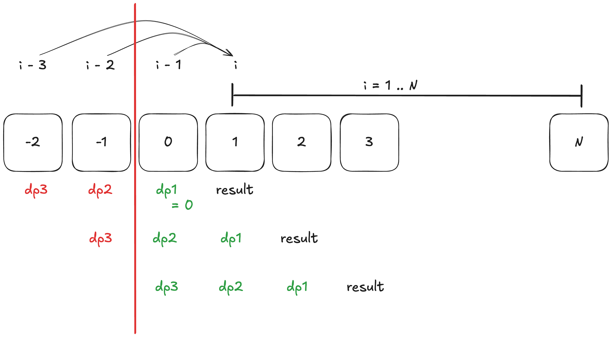

# [3693. Climbing Stairs II](https://leetcode.com/problems/climbing-stairs-ii/)

## Derivation

* **Abstractions:** Let `DP[i]` be the minimum cost to land on step `i`.

$$DP[i] = \min_{j \in \{1, 2, 3\}} (DP[i-j] + \text{costs}[i-1] + j^2)$$


* **Brute Force:** Write a recursive function that calculates all 3 branches from step $n$ all the way down to step $0$, traversing every single possible valid combination of 1, 2, and 3 steps.
* **Bottleneck Analysis:** The time complexity is $O(3^n)$. You will calculate the cost to reach step 3 multiple times because it is a sub-step for step 4, step 5, and step 6. The redundant calculations grow exponentially.
* **Pattern Recognition:** We are asked for a "minimum" (Optimization) and our current choice depends on a fixed window of earlier states (Optimal Substructure + Overlapping Subproblems). This defines **1D Dynamic Programming**.

> Q: **Why Greedy Fails Here??**

A greedy algorithm makes the best *local* choice. At step `i`, a greedy algorithm might look at the jump costs ($1^2=1$, $2^2=4$, $3^2=9$) and always choose to jump 1 step because the jump itself is cheapest.
However, it ignores the `costs` array. Step `i+1` might have a massive penalty (e.g., `costs = [1, 100, 1]`). A greedy algorithm might land on the `100` penalty step to save on jump costs, completely missing that taking a slightly more expensive 2-step jump would bypass the `100` penalty entirely. DP evaluates the global consequence of the choices.

## Dynamic Programming
```kotlin
fun climbStairs(n: Int, costs: IntArray): Int {
    // val memo = IntArray(n + 1) { -1 }
    // return to(n, costs, memo)
    return bottomUp(n, costs)
}

private fun to(i: Int, costs: IntArray, memo: IntArray): Int {
    if (i <= 0) return 0
    if (memo[i] != -1) return memo[i]
    val n1 = to(i - 1, costs, memo) + costs[i - 1] + 1
    val n2 = to(i - 2, costs, memo) + costs[i - 1] + 4
    val n3 = to(i - 3, costs, memo) + costs[i - 1] + 9

    memo[i] = minOf(n1, n2, n3)
    return memo[i]
}

private fun bottomUp(n: Int, costs: IntArray): Int {
    val dp = IntArray(n + 1) { Int.MAX_VALUE }
    dp[0] = 0
    for (i in 1..n) {
        for (j in 1..3) {
            if (i - j >= 0) {
                dp[i] = minOf(dp[i], dp[i - j] + costs[i - 1] + j * j)
            }
        }
    }
    return dp[n]
}
```

### Complexity Analysis
- Top-Down DP:
    - **Time Complexity:** `O(n)` for a single pass through the steps.
    - **Space Complexity:** `O(n)` for the DP memoization array.
- Bottom-Up DP:
    - **Time Complexity:** `O(n)` for a single pass through the steps.
    - **Space Complexity:** `O(n)` for the DP array or `O(1)` for space optimization.

### Space Optimization


```kotlin
// We only depend on the last 3 states, so we can optimize space to O(1)
private fun bottomUpSpaceOptimization(n: Int, costs: IntArray): Int {
    if (n == 0) return 0
    
    /**
     dp3, 2, 1 represent the minimum cost to reach step i-3, i-2, and i-1 respectively.
     */
    var dp3 = Int.MAX_VALUE
    var dp2 = Int.MAX_VALUE
    var dp1 = 0 // Base case: We start iteration from step 1, so we rely on step (1 - 1) = step 0, which has a cost of 0.
    var result = Int.MAX_VALUE
    
    for (i in 1..n) {
        // We have to reset result to prevent carrying over the previous step's result.
        // See below: We might not update result if we don't have a valid 
        // previous step, so result might keep the previous step's value, which is incorrect.
        result = Int.MAX_VALUE 
        
        // We update the result if we have a valid previous step to jump from (i-1, i-2, or i-3).

        if (dp1 != Int.MAX_VALUE) {
            result = minOf(result, dp1 + costs[i - 1] + 1)
        }
        if (dp2 != Int.MAX_VALUE) {
            result = minOf(result, dp2 + costs[i - 1] + 4)
        }
        if (dp3 != Int.MAX_VALUE) {
            result = minOf(result, dp3 + costs[i - 1] + 9)
        }

        // Roll the dp variables forward for the next iteration.
        dp3 = dp2
        dp2 = dp1
        dp1 = result
    }
    return result
}

// We have a equivalent implementation using direct assignment instead of sequential comparison, which allows us to avoid resetting result at the beginning of each iteration.
```

### Detailed Explanation
Compare to [70.climbing-stairs](../leetcode/70.climbing-stairs.md), we had a bit different implementation here.

* Q1: Why to reset `result` at the beginning of each iteration?
    - In 70, we use **direct assignment**: `result = previous + current`, it completely overwrites whatever `result` held prepiously.
    - In 3693, we use **sequencital comparison**: we only update `result = minOf(result, ...)` if we have a valid previous step (`dp != Int.MAX_VALUE`). If we don't reset `result`, step `i` will compare from step `i - 1`.
* Follow-up to Q1: Can 3693 avoid resetting? Yes, but we must change our structure logical to a single direct assignement instead of sequential comparison:

```kotlin
var d3 = Int.MAX_VALUE
var d2 = Int.MAX_VALUE
var d1 = 0
var result = 0 // Initial value does not matter; it gets overwritten

for (i in 1..n) {
    // 1. Isolate the path calculations (protecting against overflow)
    val p1 = if (d1 != Int.MAX_VALUE) d1 + costs[i - 1] + 1 else Int.MAX_VALUE
    val p2 = if (d2 != Int.MAX_VALUE) d2 + costs[i - 1] + 4 else Int.MAX_VALUE
    val p3 = if (d3 != Int.MAX_VALUE) d3 + costs[i - 1] + 9 else Int.MAX_VALUE

    // 2. Direct Assignment: completely overwrites 'result' without needing a reset
    result = minOf(p1, p2, p3)

    // 3. Shift the window forward
    d3 = d2
    d2 = d1
    d1 = result
}

return result
```
* Q3: How to initialize `dp` variable?
The key principle for initialization is mapping variables to the **Conceptual DP Array**. At the moment before the loop begins (`i == 1`), where do these variables point?

```js
-3, -2, -1,  0,  1,  2,  3
     d3, d2, d1, R
```
- `d1` points to `dp[0]`, which is the base case of 0, cost = 0.
- `d2` points to `dp[-1]`, which is invalid, so we set it to `Int.MAX_VALUE`.
- `d3` points to `dp[-2]`, which is invalid, so we set it to `Int.MAX_VALUE`.